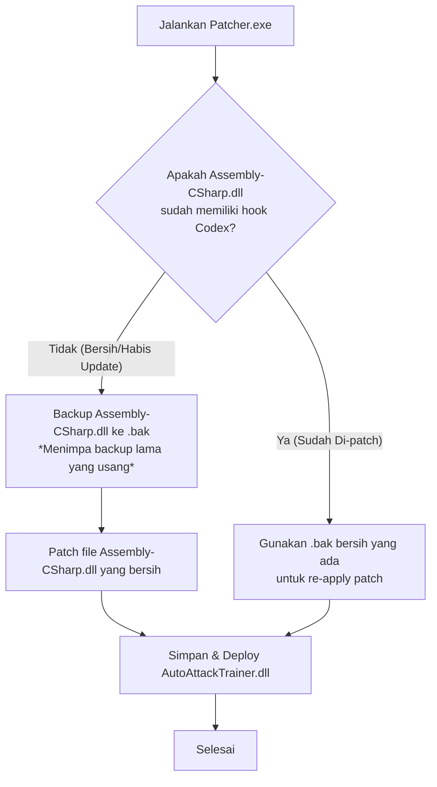

# Panduan Pembaruan Codex Trainer (Patch Guide)

Dokumen ini menjelaskan cara kerja patcher Codex yang baru, langkah-langkah penanganan ketika game mengalami pembaruan (patch) di Steam, serta informasi apa saja yang harus diberikan ke AI jika memerlukan bantuan pembaruan di masa mendatang.

---

## 1. Mekanisme Patcher Baru (Self-Healing Backup)

Patcher Codex v2.0 sekarang menggunakan logika deteksi dinamis untuk menghindari kegagalan kompatibilitas file akibat pembaruan game:

Dengan logika ini:
* **Backup selalu sinkron** dengan versi game terbaru karena backup lama otomatis tertimpa saat game bersih terdeteksi.
* Patcher tidak akan menduplikasi hook jika dijalankan berulang kali pada versi game yang sama.

---

## 2. Prosedur Standar Saat Game Update (Steam Patch)

Jika AdventureQuest Worlds Infinity melakukan update di Steam, ikuti langkah-langkah berikut:

1. **Jalankan Patcher Baru**:
   Cukup buka folder `Publish` dan jalankan kembali **`Patcher.exe`**. Logika baru akan otomatis mengenali file game bersih hasil update, memperbarui file `.bak`, dan memasang Codex kembali.
2. **Uji Coba Game**:
   Buka game dan ketik `/codex` untuk memastikan menu trainer berfungsi.

--
